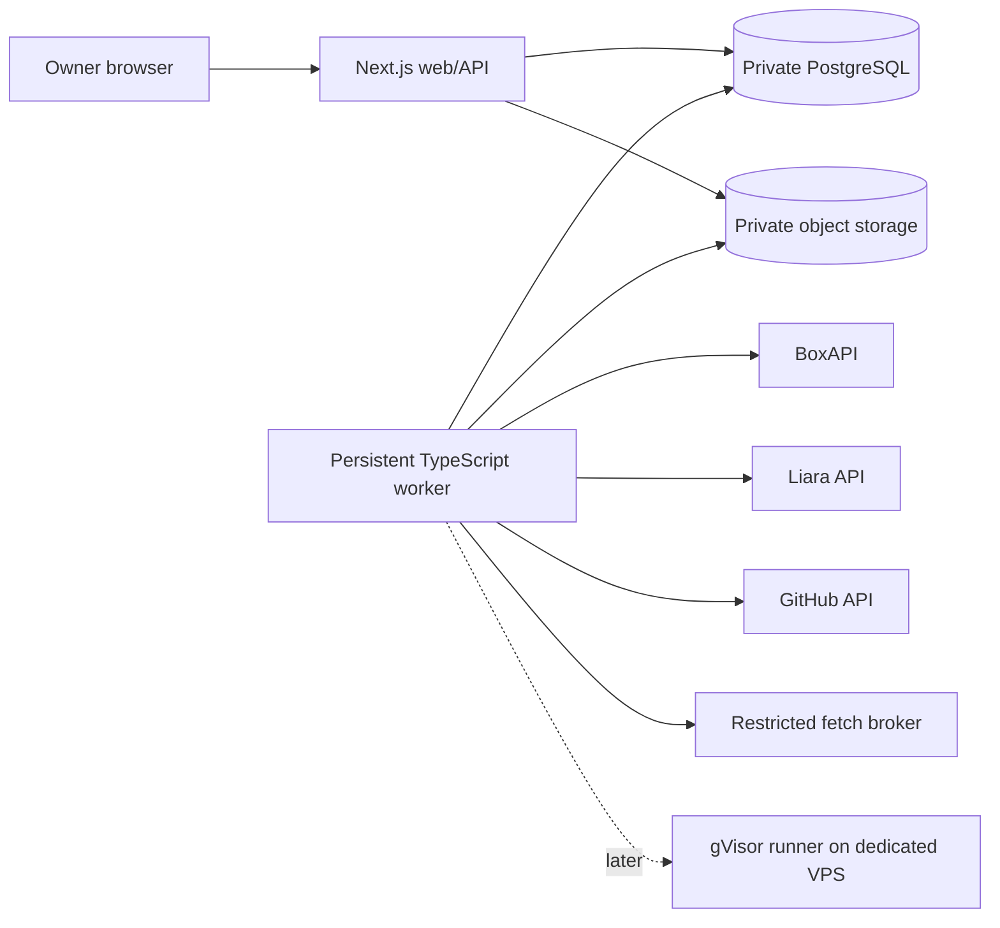

# Liara Agentic DevOps & SRE — Approved Implementation Handoff

**Status:** Approved for implementation. This file preserves the product and delivery decisions from the approved plan. It is a specification, not a claim that every described phase has been implemented.

## Current delivery slice (product-first integration)

The immediate implementation joins authenticated assistant tasks, actual Deep Agents reasoning with bounded read-only tools, immutable public GitHub source, exact server-constructed proposals, explicit owner approval and a separate durable action run. Initial deployment targets an **existing Liara app**; resource creation/plan selection requires a later exact approval. Deep Agents uses virtual in-memory state without host filesystem or shell tools. PostgreSQL persists runs/proposals/approvals, but resumable graph checkpoints and continuous monitoring are not delivered by this slice. This narrows the next milestone, not the longer-term product intent below. See [the walkthrough and current limits](docs/assistant-product-slice.md); implementation is not evidence of live success.

## 1. Product and decisions

Build a technical colleague for Liara application owners: import and understand source, deploy it, monitor it, investigate operational failures, propose bounded changes, request owner approval, execute through Liara, and verify the result. The first end-to-end milestone is **import source → understand dependencies → approve deployment → deploy → detect a fault → diagnose → approve a correction → execute → verify recovery**.

The product supports multiple customer workspaces from the start, with one owner per workspace and no initial team roles or invitation system. It ships in phases: reliable Liara operations first; schedules, skills, memory and voice second; isolated code correction third.

| Decision | Approved choice |
|---|---|
| Interface | Liara console appearance and navigation with persistent assistant |
| Language/font | Persian RTL interface, Persian and English conversations, Vazirmatn |
| Stack | TypeScript, Next.js web/API, separate persistent worker |
| Workflows | LangGraph.js with PostgreSQL checkpointing; pg-boss for background work |
| Persistence | PostgreSQL and private S3-compatible Liara object storage |
| Authentication | GitHub OAuth; repository authorization is a separate integration |
| Customer scope | One owner per workspace initially; multiple projects/connections |
| Model | BoxAPI `qwen/qwen3.7-flash` for all model roles |
| Provider credentials | Customer BYOK; operator key restricted to explicitly configured demo owner |
| Interaction | Auto default; Guided explains more; both obey the same authority rules |
| Approval | One approval for an immutable, bounded concrete change plan |
| Monitoring | On by default when a project is connected, visibly pausable |
| Notifications | Durable in-app inbox first; Telegram summaries later |
| Code execution | Static inspection first; dedicated owner-provided Liara VPS with gVisor later |
| Code change workflow | Draft PR, owner merges in GitHub, then a separate deployment approval |
| Voice | Shenava Rizeh with server-side sherpa-onnx after core operations |
| Spending | No hard currency cap; bounded model calls, usage display, and AI stop switch |
| Retention | Evidence/logs 7 days; chats/runs 30 days; audit 90 days; recovery copies may add up to 7 days |
| Time | Persist UTC, use IANA timezone `Asia/Tehran` for display and schedules |

### Cost and model policy

Use Qwen3.7 Flash. BoxAPI currently lists $0.0345 input, $0.1495 output, and $0.0069 cached input per million tokens; catalog rates are estimates, not account billing guarantees. [BoxAPI model catalog](https://boxapi.ir/docs/ai/models/). Upstream documentation lists tool calling and structured output; the exact model/key combination must pass one bounded implementation smoke test. [Alibaba Cloud Qwen3.7 Flash](https://www.alibabacloud.com/help/en/model-studio/qwen3-7-flash).

- Do not switch models/providers automatically or use GPT-6 Luna or GPT-5.4 Mini as fallback.
- If the exact model is denied, keep live AI disabled and report the access prerequisite.
- Limit the demo workspace to one concurrent model call and four calls per ordinary run, including retries/specialist calls.
- Target at most 12,000 input tokens per call; default output 1,200 tokens, planning 1,600.
- Later, explicitly requested code correction may use up to eight calls and 4,000 output tokens per call.
- Deterministic polling, health checks, deduplication, condition evaluation, and validated workflows use no model calls.
- Reuse evidence and validated workflows. Show usage by run/project/workspace/model and provide a stop switch that blocks new model dispatch.
- Record provider-reported cost separately from catalog estimate; never assume currency when the provider does not establish it.

### Scope and research conclusions

Manage verified Liara capabilities for PaaS apps/releases/configuration/restart/power/resize, managed databases/backups, persistent disks, domains/TLS/DNS, and object storage. VPS administration is excluded from the initial assistant tools; the later dedicated VPS exists for the runner only. Registrar ownership, unavailable APIs, and unsupported private-network configuration use a recorded human handoff.

Use explicit LangGraph workflows and narrow specialists rather than a general harness with broad filesystem/shell authority. Checkpointing does not provide tenant authorization or exactly-once provider effects. Use pg-boss for durable work but retain application-level idempotency and operation reconciliation. [LangGraph interrupts](https://docs.langchain.com/oss/javascript/langgraph/interrupts), [PostgreSQL checkpointer](https://github.com/langchain-ai/langgraphjs/blob/main/libs/checkpoint-postgres/README.md), [pg-boss](https://pgboss.io/).

Established AI SRE products inform the evidence → hypotheses → bounded action → verification interaction; their marketing claims are not performance evidence. Curated skills must retain pinned provenance and license terms. [incident.io](https://incident.io/solution/ai-sre), [Rootly](https://rootly.com/ai-sre), [Cleric](https://cleric.ai/), [Vercel React skill](https://github.com/vercel-labs/agent-skills/blob/main/skills/react-best-practices/SKILL.md), [Supabase skills](https://supabase.com/docs/guides/ai-tools/ai-skills), [web-quality skill](https://github.com/addyosmani/web-quality-skills/blob/main/skills/performance/SKILL.md).

## 2. Architecture and execution contracts

### Runtime and deployment

Use one pnpm TypeScript repository. The web process owns UI, auth, tenant-scoped APIs, upload, approval, and authenticated event streaming. A separately running long-lived worker owns durable runs, collectors, schedules, provider calls, reconciliation, and retention. A runner controller is introduced only in the later code-execution phase. Keep shared schemas, domain logic, database access, policy, and integrations in the same repo.

Use Node 24 on Debian, Next.js/React, Tailwind/shadcn/Radix, Zod, Drizzle, LangGraph.js, the official Node `openai` SDK pointed at BoxAPI, pg-boss, PostgreSQL full-text search, and private S3-compatible storage. Build web and worker from the same image with different commands. Pin dependencies. Do not add Redis, a vector/graph database, or paid telemetry initially.

Host on Liara. Keep PostgreSQL private where supported and all essential state in PostgreSQL/object storage, never the ephemeral app root. Track liveness, readiness, worker heartbeat, and (later) runner availability separately. A web restart cannot lose run state. [Liara private networking](https://docs.liara.ir/llms/paas/details/private-network.md)

### Tenant identity, auth, and secrets

Use Auth.js GitHub OAuth with database sessions. The verified GitHub provider identity establishes the owner; submitted emails/usernames do not. Repository read authorization uses a GitHub App installation scoped to selected repositories. Ask for write permissions only in the PR phase.

Every query, API, stream, job, artifact, graph checkpoint, retrieval, and knowledge operation is scoped to the owning workspace. A caller-provided object ID never grants access. Use composite workspace constraints where useful. A worker resolves ownership from stored domain rows, not job payload claims.

Encrypt customer integration credentials and app secrets with authenticated encryption. Keep the master key in deployment environment configuration outside the DB. Models only receive opaque versioned secret references; only the execution broker resolves them. Bind secret versions into approval. Secret forms are separate from chat. Disconnect blocks pending future credential use. Never log credentials in errors, logs, audit records, tracing, or graph checkpoints. Restrict the operator demo key to an explicitly configured demo owner; a failed BYOK never falls back to it. Liara detail responses may include environment values: produce safe DTOs before logging, storing, or passing responses to a model. Apply the same rule to database credentials.

### Data and shared contracts

Use PostgreSQL for identity/sessions, workspaces, projects, connections and credential versions, capabilities, resources and dependency edges, source revisions/artifacts, deployments, conversations, runs/events, evidence, plans/approvals/operations/reservations, schedules/hooks/incidents, knowledge/skills/workflows, inbox, usage/prices, outbox, and audit. Use opaque internal IDs and keep provider IDs separate. For Liara apps, store both internal provider ID and `project_id` slug. UTC timestamps; display/scheduling in `Asia/Tehran`.

Define and validate before workflows: `ResourceRef` (workspace/connection/type/provider ID/slug); `SourceRef` (immutable commit or archive digest/artifact); `EvidenceRef` (scope/source/time/expiry/integrity digest); `Finding` (statement/evidence/confidence/limitations); `ActionPlan` (version/scope/ordered steps/resource bindings/preconditions/cost/disruption/verification/canonical hash); `Approval` (plan hash/version/owner/decision/time/expiry); `Operation` (stable ID/step/dispatch/resource reservation/correlation/outcome); `RunEvent` (run/monotonic sequence/type/safe payload/time); `Capability` (supported, unsupported, or unverified plus evidence/time); `UsageRecord` (model/tokens/provider cost and unit/catalog estimate/source/run); and `WorkflowVersion` (typed steps/tools/preconditions/validation/provenance).

### HTTP API and durable work

Expose authenticated same-origin API groups for connections, projects/resources, sources, conversations, runs, plans/approvals, monitoring/incidents, automations, knowledge, inbox, and usage/AI stop. Long work returns `202` with run ID. Stream authenticated SSE with durable sequence IDs and `Last-Event-ID` replay. Use consistent errors (`code`, safe `message`, `correlationId`, `retryable`, optional field errors); stale plan/precondition versions return conflict. Protect state-changing browser calls with session/origin/CSRF checks. Verify GitHub webhook signatures and deduplicate delivery IDs.

Keep application, pg-boss, and LangGraph checkpoints in separate DB schemas. Write an outbox item in the same transaction as its domain event, then dispatch it to pg-boss; handlers tolerate redelivery. Run an approximately one-second outbox dispatcher, one-minute schedule dispatcher, unique `(schedule_id, scheduled_at)` run key, worker heartbeats, bounded provider backoff/polling, and recovery jobs.

Run states: `queued`, `running`, `waiting_input`, `waiting_approval`, `waiting_external`, `verifying`, `succeeded`, `failed`, `cancelled`, `outcome_unknown`. Waiting must not burn an active model loop.

### Approval, broker, and uncertain mutations

Every infrastructure mutation goes through an immutable `ActionPlan`. Display target customer/project, exact existing provider resources, new-resource specs, exact source commit/digest, ordered steps/dependencies, concealed secret references, disruption, known costs and unknowns, preconditions, verification, and any proposed recovery. Canonicalize and hash the full plan. Approval binds only that version and lasts 30 minutes for dispatch. Recheck preconditions before each dispatch; if approval expires in flight, observe/reconcile the operation but require renewed approval for subsequent mutations. Any source/account/resource/size/config/secret/dependency change invalidates approval. Bind new logical resource refs exactly once to the resulting provider ID after account/attributes checks; never adopt a same-name resource implicitly.

Keep an operation ledger independent of LangGraph state. Persist intent, atomically claim dispatch, reserve affected resources/names, verify approval/preconditions, then dispatch. Record provider IDs promptly. Timeouts/crashes after dispatch become `outcome_unknown`; halt dependent writes and reconcile using provider IDs, release history, observed config/events, or other reliable evidence. Never resend an ambiguous create/restart/deploy just because a queue was redelivered or lease expired. If outcome cannot be proven, show uncertainty and require explicit resolution. Do not automatically delete as compensation. Stop blocks new dispatch; in-flight work can finish and must be reconciled.

Credentialed adapters use fixed service origins. Public probes use a restricted fetch broker: HTTPS/443 by default, explicit HTTP/80 only; reject loopback/private/link-local/metadata/reserved and encoded private IPs (IPv4 and IPv6); resolve at connection time and connect only to vetted public addresses while preserving TLS hostname verification; revalidate up to three redirects; never forward credentials across origins; cap time, size, and concurrency; enforce network egress too. Arbitrary customer MCP/webhook targets and private-network probes are deferred.

### Source ingestion and app behavior

Accept public GitHub repos, authorized private GitHub repos, ZIP, and tar.gz. Resolve immutable commits. Limits: 50 MiB upload, 256 MiB expanded, 10,000 files, bounded per-file/model excerpts; no nested archive expansion, submodules, or LFS expansion. Reject traversal/absolute/duplicate paths, unsafe drive/backslash paths, NUL, links, special files, and expansion-limit violations. Static inspection executes no install, build, tests, hooks, helpers, or executable config. Exclude `.env`, credentials, private keys, Git auth material, dependencies, and build output from model context and deployment bundle. Collect required app secrets separately. The Liara source build is its own approved boundary and receives no control-plane/model credentials.

Project picture records facts/edges with workspace/project/resource scope, provenance (repo inference, owner statement, or live observation), evidence, time, confidence, and expiry. Detect common manifests and deployment files without a fixed stack allowlist. Produce component inventory, runtime/build/deployment requirements, ports/health candidates, required environment variable names, dependencies, Liara associations, and unknowns. Refresh on import/deploy/config change and periodically (10–15 minutes); never replace observed state with inference.

Initial deployment: resolve source → static analysis → project picture → ask only for missing decisions/secrets → smallest suitable verified plan → immutable approval → dependency-ordered resource creation → configure secrets by reference → upload/deploy → observe release/build → verify public app/dependencies → report URLs, revision, resources, cost/unknowns, and handoffs. If commands/build behavior cannot be safely inferred, ask owner rather than executing source. Import existing apps read-only first; associate a repo only by explicit match.

Diagnosis gathers symptom/time/resource and bounded evidence, compares releases/config/health/telemetry, ranks hypotheses, checks with read-only tools, reports evidence-linked observed/likely/unresolved causes, prepares bounded correction, requests approval, executes via broker, verifies, and records outcome. Before runner phase, source may be inspected but tests may not be claimed. Scaling is one hypothesis, not the default fix.

### Monitoring, schedules, memory

Use deterministic public health checks every 60 seconds where safe, open an availability incident after three consecutive failures, bound metrics/log collection, reconcile resources every 10–15 minutes, and establish units before CPU/RAM thresholds or latency baselines. For private apps use available provider status and report limitations. Fingerprint and coalesce incidents, append evidence, use a ten-minute cooldown, do one initial investigation and reawaken only on material evidence change. Never run an LLM per log line or call one HTTP 400 an incident.

Schedules/hooks are visible typed records with timezone, cadence, target, permitted read workflow, execution history, next run, pause control. Routine checks remain deterministic; reports are generated only on explicit request. Skip missed health polls; permit one report catch-up. Hook conditions are bounded status/numeric/literal-match/count/boolean trees. No `eval`, arbitrary scripts, or unbounded regex. Explicit user-requested schedules can activate with recap; model-suggested schedules remain drafts. Neither can authorize mutations.

Keep project picture, memory, skills, and workflows distinct. Generate compact `MEMORY.md`-style overview from scoped DB records and retrieve details on demand with full-text search. Auto-save outcome-backed findings, confirmed conventions, successful read-only procedures, and owner corrections; never save guesses as facts or grant authority. Promote repeated procedures only after explicit preconditions, positive/negative fixtures, successful read-only dry run, fixed tools/output limits, and provenance/version. Arbitrary scripts wait for runner.

Curate Vercel React/Next, Supabase PostgreSQL, and Addy Osmani performance guidance, loading only relevant material. Pin revisions, preserve licenses/provenance/adaptations, and verify Vercel redistribution license before copying (link until checked). Skills/memory never override approval policy.

### Liara and BoxAPI

BoxAPI: `https://ai.boxapi.ir/ai/v1`, Bearer auth, OpenAI-compatible Chat Completions. The prior key was tested against another model; the selected Qwen model still needs one bounded two-request smoke test (typed function call, tool result and streamed final answer, small output cap, inspect usage). No more planning probes. 401/403 disables live AI; no fallback. 429/transient retries are bounded and count against run allowance. Respect provider parameter compatibility; avoid assumed optional parameters. [BoxAPI model docs](https://boxapi.ir/docs/ai/).

Liara: `https://api.liara.ir`, Bearer token plus `teamID` query parameter for teams. Use application `project_id` slug in routes, preserve internal ID separately. The latest planning account check succeeded with an empty project list; dedicated demo resources remain a setup prerequisite. Maintain per-connection capability evidence: documented, account-tested, unsupported, or unverified.

| Capability | Required behavior |
|---|---|
| Application list/detail | Read real metadata and strip environment values immediately |
| Deploy | Upload archive, create release, preserve source/release IDs, verify terminal state |
| Release observation | Use documented release history baseline |
| Restart, power, resize | Approved mutations with reconciliation and current cost/unknowns |
| Logs | Bounded cursor collection; isolate route/format compatibility |
| Metrics | Keep units unknown until validated; missing is never zero |
| DB/backups, DNS/domains/TLS, disks/storage | Implement only verified capabilities and show unsupported/human handoff honestly |

Documented deployment uploads source and creates a release. The CLI suggests extra release-status/build-log/cancel/runtime-log routes: keep these in a compatibility adapter with account tests, not as public API guarantees. There is no evidenced native rollback; recover by a new approved deploy from retained immutable known-good source. [Liara API catalog](https://developers.liara.ir/llms.txt), [source upload](https://developers.liara.ir/pass/deploy/deploy-sources-code.md), [release creation](https://developers.liara.ir/pass/deploy/deploy-releases.md), [CLI](https://github.com/liara-cloud/cli/blob/master/src/commands/deploy.ts), [logs](https://github.com/liara-cloud/cli/blob/master/src/commands/app/logs.ts), [CPU reports](https://developers.liara.ir/pass/reports/get-cpu-reports-of-app.md).

### User interface

Use assets/RTL/font patterns from `/home/hamidreza/projects/starcoach-hackaton` as reference, adapting rather than copying its application state/business logic. Match observed Liara console: `#181818` page, `#23252D` cards, `#87FCC4`→`#28C1F5` gradient, ~12px cards/~8px controls, two top nav levels, right ~240px contextual sidebar, Liara tables/status/spacing, persistent ~360–420px assistant on left. Use semantic tokens, accessible shadcn components/forms/dialogs. On mobile use drawer navigation and full-screen assistant. Keep technical text, URLs, IDs, logs, code in LTR isolates. Show unavailable/stale/waiting/partial/uncertain states honestly; show progress, never hidden chain-of-thought.

Screens: overview; project dependency picture; app overview/releases/logs/metrics/domains/disks/settings; database/storage/DNS; assistant with context/progress/questions/findings/actions; change-plan diff/cost/disruption/approval; incident evidence/timeline/hypotheses/verification; automations; knowledge/provenance; inbox; settings/connections/usage/retention/stop.

### Later voice, runner, notifications

Phase 2 voice: Shenava Rizeh sherpa-onnx native Node. Maximum 60 seconds, normalize to mono 16kHz, checksum-pinned lazy-loaded model. Show editable transcript and require explicit send; delete audio on success/failure, no retention. Test Persian/English technical vocabulary, domains, app names, digits, abbreviations, noise, latency and memory on Liara. Do not depend on unverified browser WASM. [Model](https://huggingface.co/Reza2kn/Shenava-Rizeh-v1.0-sherpa-onnx), [Node install](https://k2-fsa.github.io/sherpa/onnx/javascript-api/install.html).

Phase 3 code correction: owner-provided dedicated Liara VPS, gVisor `runsc`, fail closed if unavailable; ephemeral job; enforce CPU/RAM/PID/disk/network/wall time; no host mounts, privileged mode, container socket, production secrets; restricted egress; separate controller; typed jobs and validated artifacts; destroy workload. Flow: approved source → isolated patch/tests → draft PR → human GitHub merge → inspect exact merged commit → new deployment approval → deploy/verify. No automatic merge or drifting branch deploy. E2B is excluded.

Start in-app inbox. Later Telegram sends minimized summaries and authenticated app links, with deduplicated delivery; never logs/secrets or approval commands.

## 3. Phased delivery and acceptance

### Phase 0 — Foundations and feasibility

Create repository/lockfile/local setup; PostgreSQL migrations/private artifact storage; GitHub sign-in/workspace ownership; encrypted connections; BoxAPI adapter and single exact-model smoke; Liara safe reads/capabilities; outbox/worker/durable events/runs; explicit fixture mode.

Exit only when the exact Qwen model and required tool round trip work (or live AI is clearly disabled with the permission issue), streaming/usage behavior is understood, no automatic fallback exists, Liara team scope is verified, safe DTOs prevent provider-secret leaks, a run survives web/worker restart, and workspaces are isolated.

### Phase 1 — Real operational milestone

Liara-style shell and assistant; source import/static analysis/project picture; resource import; deployment plans/approvals; broker/ledger/reservations/reconciliation; release/log/health observation; deterministic monitoring; diagnosis and approved infrastructure correction; incident/result/usage/stop UI; basic verified service management.

Use a disposable demo app and small DB where useful. Fault injection must be a controlled reversible approved config change, never an unauthenticated fault endpoint.

Exit when a real repo/archive deploys to Liara with exact revision/release shown; three failed checks create one incident; diagnosis cites actual evidence; correction requires approval; three successful checks plus provider evidence verify recovery; refresh/worker restart preserve progress; no duplicate resources or replayed ambiguous mutations; scenario demos in ~5 minutes.

### Phase 2 — Ongoing colleague

Schedules/hooks, incident grouping, controlled investigation, scoped memory, outcome-backed notes, validated read workflows, curated skills, relationships/reconciliation, Persian voice, reporting/usage. Exit: zero model calls for routine checks; error burst coalesces; pause survives restart; validated workflow avoids LLM; stale knowledge invalidates; voice is reviewed before send; retention deletes all live copies.

### Phase 3 — Tested code and notifications

Dedicated gVisor VPS/controller, isolated jobs/artifacts, patch/tests, draft PR, manual merge tracking, exact-commit deployment approval, Telegram. Exit: isolation/egress tests pass; no host fallback or production secrets; honest test results; PR validation actual; human merge and deploy approval separate; deployed SHA matches approved merge.

### Required verification

Use fixtures for breadth and a small number of live checks only on disposable approved resources. Fixtures must never be presented as live success.

| Area | Scenarios |
|---|---|
| Ownership | Cross-workspace IDs in APIs/SSE/jobs/checkpoints/artifacts/knowledge/approvals |
| Secrets | Canary values in provider responses/errors, model inputs, logs, checkpoints, audit |
| Approval | Changed source/plan/account/secret/cost/precondition, expiry |
| Resource binding | Name collision and attempted adoption; one-time logical ref binding |
| Durability | Duplicate jobs, worker restart, approval resume, repeated webhook |
| Mutation uncertainty | Crash before/during/after provider success, stale lease, overlapping plans |
| Network | Private IPv4/v6, metadata, encoded IP, rebinding, redirect, credential forwarding |
| Archives | Traversal, links, duplicate paths, special files, expansion/nested archives |
| Providers | 401/403/429/5xx, malformed payload, invalid tools, interrupted stream |
| Monitoring | Event storm, unchanged incident, pause/cooldown, missing metric |
| Cost | Call bounds, no fallback, stopped dispatch, deterministic polling |
| Retention | Evidence, artifacts, checkpoints, chats, audit, exports, restored backups |
| UI | RTL/LTR, keyboard, readable approval, mobile, stale/unknown/partial states |
| Voice/runner | Mixed vocabulary/noise/deletion; actual gVisor, host isolation, secrets, egress, cleanup |

Start from shared contracts and security/execution foundations. Once stable, parallelize UI, Liara read adapters/fixtures, static source ingestion, and worker/event plumbing. Serialize approval/dispatch/reconciliation until their contract is stable. Have security specialists review tenant isolation, credentials, SSRF, runner; independently verify integrated milestones.

## 4. Operations, prerequisites, and completion

### Prerequisites

Planning credentials already exist in local `.env`: `BOX_API_KEY`, `LIARA_API_TOKEN`, `LIARA_TEAM_ID`; `AGENT_ROUTER_API_KEY` is no longer a runtime dependency. Never copy values to docs, source, screenshots, logs, or demo. Implementation setup still needs:

| Prerequisite | Purpose |
|---|---|
| GitHub OAuth app | Sign-in |
| GitHub App/install and selected repo grants | Private source now; PR writing later |
| Explicit demo-owner GitHub identity | Restrict operator-funded model key |
| Liara web/worker apps and PostgreSQL | Product runtime/data/jobs |
| Private object bucket/credentials | Source/evidence artifacts |
| Separate app encryption key | Protect stored credentials |
| Dedicated demo resources | Approved real operations |
| Owner VPS with gVisor, phase 3 | Isolated code execution |
| Telegram bot, phase 3 | Optional notifications |

No custom product domain blocks phase 1; use Liara default domain. Paid resources must be approved in concrete plans.

### Visibility and control

Emit structured redacted logs with correlation IDs across HTTP/run/job/provider operation. Track worker heartbeat/queue age, outbox failures, stuck runs, pending approvals, uncertain operations, collector lag/provider failures, tokens/cost, object storage, retention, and later runner health. No prompt-content tracing or paid tracing by default.

Separate controls: stop run (blocks new work for run), pause monitoring (project collection), pause AI (new model calls only), disconnect integration (future credential use). Explain dispatched provider work may finish. Document worker restart, provider outage/rate limit, expired credentials, uncertain mutation, unhealthy release, DB restore, encryption-key replacement, storage cleanup, and runner outage.

### Retention, backups, docs, demo

| Data | Retention |
|---|---|
| Raw logs and evidence | 7 days |
| Chats and run history | 30 days |
| Audit | 90 days |
| Minimized reusable knowledge | Until removed/invalidated |
| Voice | Delete after transcription/failure |
| Source bundles | Current plus at most two prior successful bundles, normally ≤30 days |

Keep the current deployed source reference while required. Do not copy raw logs into long-lived summaries/memory/checkpoints; retain references and minimized findings. Use encrypted rolling recovery backups with at most seven extra retention days. Before restored data becomes available, run expiry cleanup and replay deletion records. Cover exports, object versions, temp files, checkpoints, and backup rotation.

Markdown docs: architecture/process boundaries, local setup/env, Liara auth/team/capability matrix, model/cost, API/contracts, approval/reconciliation, deployment/recovery/retention runbooks, security/limitations, demo setup/script. Preserve original product brief as context.

Five-minute demo: introduce problem/workspace; import/show components; inspect/approve/deploy; show app; trigger controlled fault; show one evidence-based incident; approve correction; show verified recovery/outcome; briefly show usage/background monitoring/limitations. Submission includes runnable MVP, Markdown docs in GitHub, and required demo video.

Completion means phased features share tenant-scoped durable approval-enforced execution; real Liara demo succeeds; usage is visible/bounded; failures are honest/recoverable; docs let another engineer operate and extend. An accepted API request is not completion; verify intended operational outcome.
